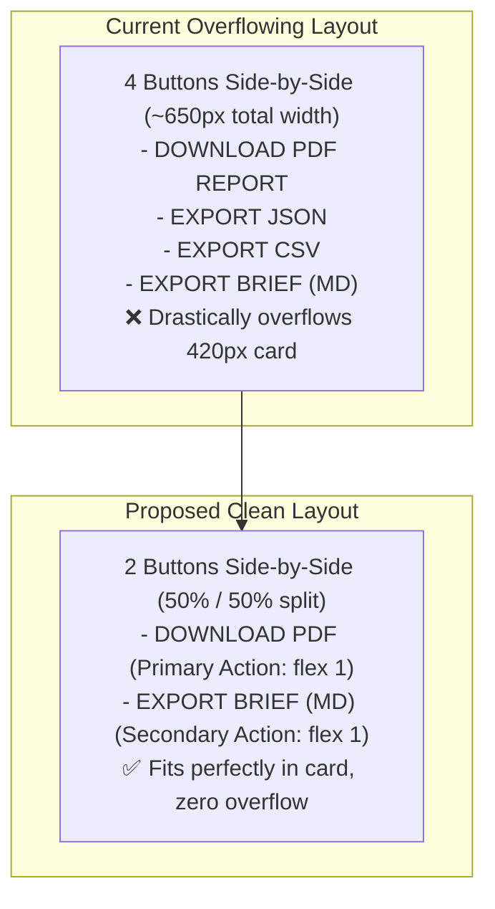

# Implementation Plan: Export Buttons Removal (CSV/JSON) & Fit Layout (PDF/Markdown)

**Target Goal**:
1. Remove `EXPORT CSV` and `EXPORT JSON` buttons from `AnalysisResultView.svelte`.
2. Remove the background generation functions (`exportReportAsJson`, `exportReportAsCsv`, and `escapeCsv`) from `exportService.ts`.
3. Fit the remaining two buttons (`DOWNLOAD PDF` and `EXPORT BRIEF (MD)`) into a responsive 50/50 flex-wrap grid inside the card so they never overflow across all screen sizes.

---

## 1. Confirmed Design Decisions (from `/grill-me` Review)

| # | Architecture Decision | Confirmed Approach | Rationale |
|---|---|---|---|
| **1** | **Buttons Layout** | **Side-by-side 50/50 grid with `flex-wrap: wrap`** | Both buttons share equal width inside the card (`flex: 1 1 140px`), adapting smoothly and wrapping cleanly if the panel is resized below ~320px. |
| **2** | **Button Labeling** | **Streamlined Compact Labels** | Change `"DOWNLOAD PDF REPORT"` &rarr; `"DOWNLOAD PDF"` and `"EXPORT BRIEF (MD)"` &rarr; `"EXPORT BRIEF (MD)"` for a tighter, cleaner presentation that prevents horizontal clipping. |
| **3** | **Visual Hierarchy** | **Primary (PDF) + Companion Secondary (MD)** | PDF button styled as prominent primary action (darker teal/slate background `#132e35`) and Markdown as clean secondary companion (subtle outline with matching hover). |
| **4** | **Background Code Cleanup** | **Complete Removal of CSV/JSON Code** | Delete `exportReportAsJson`, `exportReportAsCsv`, and `escapeCsv` from `exportService.ts` and their handlers from `AnalysisResultView.svelte`. |

---

## 2. Technical Architecture & Transformation Map



---

## 3. Step-by-Step Implementation Specifications

### Phase 1: Background Service Cleanup (`ui/src/lib/services/exportService.ts`)

1. **Delete `exportReportAsJson`**:
   Remove lines 6–42 that constructed the JSON payload and triggered the JSON blob download.
2. **Delete `exportReportAsCsv` and `escapeCsv`**:
   Remove lines 47–80 that built CSV headers, escaped strings, and triggered the CSV blob download.
3. **Retain Clean Markdown Export**:
   Keep `exportReportAsMarkdown(report: AnalysisReport): void` and the shared download helpers `downloadBlob` and `sanitizeFilename`.

---

### Phase 2: Component Cleanup & Markup (`ui/src/lib/components/AnalysisResultView.svelte`)

#### 2.1 Update Imports & Handlers
1. In script imports:
   ```typescript
   // Before:
   import {
     exportReportAsJson,
     exportReportAsCsv,
     exportReportAsMarkdown
   } from '$lib/services/exportService';
   import { Download, FileCode, FileText, ... } from 'lucide-svelte';

   // After:
   import { exportReportAsMarkdown } from '$lib/services/exportService';
   import { Download, FileText, ... } from 'lucide-svelte'; // Remove FileCode if unused
   ```
2. Delete functions:
   - `handleDownloadJson()`
   - `handleDownloadCsv()`

#### 2.2 Update Export Card Markup
Replace lines 216–253 with the clean two-button structure:
```svelte
<!-- Action Export Panel -->
<div class="export-card">
  <h4 class="export-title">AUDIT REPORT EXPORT</h4>
  <div class="export-buttons">
    <button
      type="button"
      class="btn-pdf-export"
      disabled={isDownloadingPdf}
      onclick={handleDownloadPdf}
      title="Download official PDF compliance audit report"
    >
      {#if isDownloadingPdf}
        GENERATING PDF...
      {:else}
        <Download size={14} /> DOWNLOAD PDF
      {/if}
    </button>
    <button
      type="button"
      class="btn-md-export"
      onclick={handleDownloadMarkdown}
      title="Export executive Markdown briefing for counsel"
    >
      <FileText size={14} /> EXPORT BRIEF (MD)
    </button>
  </div>
</div>
```

---

### Phase 3: CSS Layout & Sizing Specifications (`AnalysisResultView.svelte`)

Update the CSS for `.export-buttons`, `.btn-pdf-export`, and `.btn-md-export`:

```css
.export-card {
  background: #0d1724;
  border: 1px solid rgba(107, 138, 153, 0.2);
  border-radius: 6px;
  padding: 0.85rem 1rem;
  display: flex;
  flex-direction: column;
  gap: 8px;
}

.export-title {
  font-family: var(--font-mono);
  font-size: 0.68rem;
  letter-spacing: 1.5px;
  color: var(--cyan-muted);
  font-weight: 700;
}

.export-buttons {
  display: flex;
  gap: 8px;
  flex-wrap: wrap;
  width: 100%;
}

/* Primary PDF Button */
.btn-pdf-export {
  flex: 1 1 140px;
  display: inline-flex;
  align-items: center;
  justify-content: center;
  gap: 6px;
  font-family: var(--font-title);
  font-size: 0.76rem;
  font-weight: 700;
  letter-spacing: 1px;
  color: #e2f1f8;
  background: #132e35;
  border: 1px solid #1e434c;
  border-radius: 4px;
  padding: 8px 12px;
  cursor: pointer;
  white-space: nowrap;
  transition: all 0.2s cubic-bezier(0.16, 1, 0.3, 1);
  box-sizing: border-box;
}

.btn-pdf-export:hover:not(:disabled) {
  background: #1c3f48;
  border-color: #2a5863;
  transform: translateY(-1px);
}

/* Secondary Markdown Button */
.btn-md-export {
  flex: 1 1 140px;
  display: inline-flex;
  align-items: center;
  justify-content: center;
  gap: 6px;
  font-family: var(--font-title);
  font-size: 0.74rem;
  font-weight: 600;
  letter-spacing: 1px;
  color: #a0b3c2;
  background: rgba(19, 46, 53, 0.35);
  border: 1px solid #1e434c;
  border-radius: 4px;
  padding: 8px 12px;
  cursor: pointer;
  white-space: nowrap;
  transition: all 0.2s cubic-bezier(0.16, 1, 0.3, 1);
  box-sizing: border-box;
}

.btn-md-export:hover {
  background: rgba(28, 63, 72, 0.6);
  border-color: #2a5863;
  color: #e2f1f8;
  transform: translateY(-1px);
}

/* Light Theme Styling */
:global([data-theme="light"]) .btn-pdf-export {
  background: #69818d;
  border-color: #8a9aa8;
  color: #ffffff;
}

:global([data-theme="light"]) .btn-pdf-export:hover:not(:disabled) {
  background: #5a7380;
  border-color: #69818d;
}

:global([data-theme="light"]) .btn-md-export {
  background: rgba(105, 129, 141, 0.2);
  border-color: #8a9aa8;
  color: #2d3a45;
}

:global([data-theme="light"]) .btn-md-export:hover {
  background: rgba(105, 129, 141, 0.35);
  color: #1a252f;
}
```

---

## 4. Verification & Testing Checklist

| Test Case | Interaction / Screen | Expected Behavior |
|---|---|---|
| **TC-EXP-01: Card Fit in Standard View** | Complete scan and view results panel (~420px width). | Both `DOWNLOAD PDF` and `EXPORT BRIEF (MD)` sit side-by-side with zero horizontal overflow outside the card boundaries. |
| **TC-EXP-02: Narrow Panel Responsiveness** | Resize panel down to <= 320px width (e.g. via resizer splitter). | The two buttons wrap gracefully into a stacked 2-row layout without clipping text. |
| **TC-EXP-03: PDF Download Execution** | Click `DOWNLOAD PDF`. | Generates official PDF compliance report; displays `GENERATING PDF...` while downloading. |
| **TC-EXP-04: Markdown Export Execution** | Click `EXPORT BRIEF (MD)`. | Triggers download of `.md` legal executive briefing. |
| **TC-EXP-05: Dead Code Removal Verification** | Code inspection & `svelte-check`. | Zero dead code references to `exportReportAsJson` or `exportReportAsCsv`; 0 typecheck errors. |
