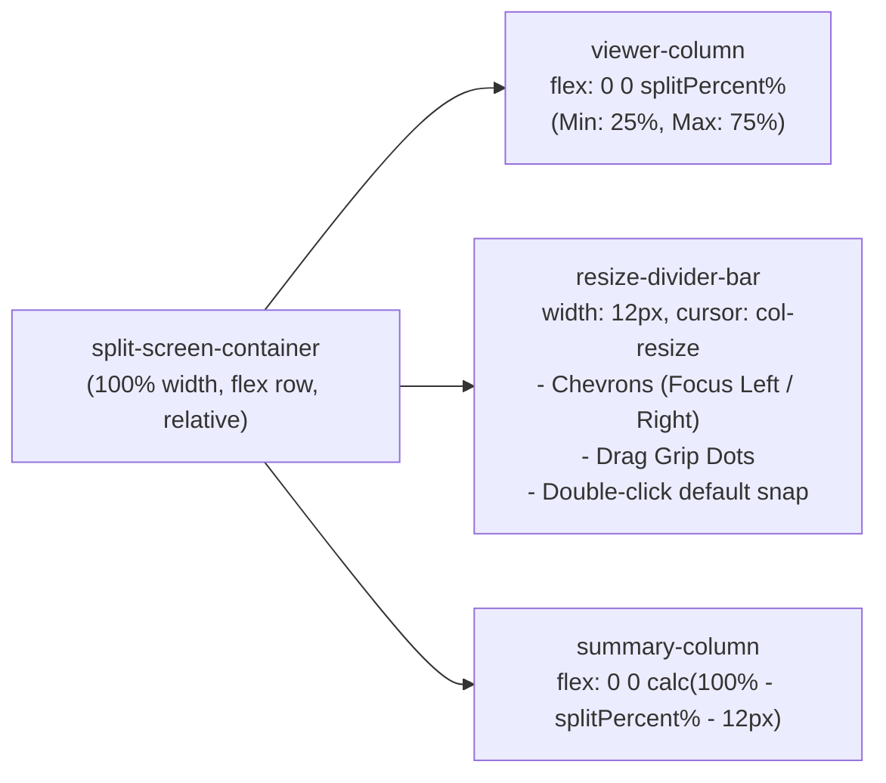

# Implementation Plan: Horizontally Resizable Split-Screen Panels (PDF Viewer & Findings)

**Target Goal**: Enable users to dynamically resize the PDF document viewer and the compliance findings summary horizontally relative to each other with a continuous draggable splitter, quick snap buttons, and local storage persistence.

---

## 1. Confirmed Design Decisions (from `/grill-me` Review)

| # | Architecture Decision | Confirmed Approach | Rationale |
|---|---|---|---|
| **1** | **Resize Interaction Model** | **Continuous Drag Handle with Percentage Split** | Draggable divider with real-time mouse/touch event listeners. Clamped between 25% (min PDF) and 75% (max PDF), with default ~58%/42%. |
| **2** | **Quick Snap & Reset** | **Double-Click Reset + Quick Snap Chevrons** | Double-clicking the divider bar snaps back to the default ratio (58/42); inline chevron buttons allow instant one-click focus on PDF (75/25) or Findings (30/70). |
| **3** | **Persistence** | **Persist to `localStorage` (`kagua_split_ratio`)** | The customized split ratio is automatically saved on mouse release (`mouseup`), restoring the user's preferred layout across scans and reloads. |
| **4** | **PDF Canvas Behavior** | **Fluid CSS Container Resizing with Centered Scroll** | Panel flex containers resize fluidly at 60fps; the PDF canvas maintains its zoom level and centers smoothly without expensive canvas re-rendering during drag. |

---

## 2. Technical Architecture & Component Structure



---

## 3. Implementation Details for `AnalysisResultView.svelte`

### 3.1 State & Event Handlers
Add reactive state and event handlers in `AnalysisResultView.svelte`:

```typescript
const DEFAULT_SPLIT_PERCENT = 58;
const MIN_SPLIT_PERCENT = 25;
const MAX_SPLIT_PERCENT = 75;
const STORAGE_SPLIT_KEY = 'kagua_split_ratio';

let splitPercent = $state(DEFAULT_SPLIT_PERCENT);
let isDraggingSplitter = $state(false);
let splitContainer = $state<HTMLDivElement | undefined>(undefined);

// Load persisted split ratio on mount
onMount(() => {
  if (typeof window !== 'undefined') {
    const saved = localStorage.getItem(STORAGE_SPLIT_KEY);
    if (saved) {
      const parsed = parseFloat(saved);
      if (!isNaN(parsed) && parsed >= MIN_SPLIT_PERCENT && parsed <= MAX_SPLIT_PERCENT) {
        splitPercent = parsed;
      }
    }
  }
});

function startDragging(e: MouseEvent) {
  e.preventDefault();
  isDraggingSplitter = true;
  document.body.style.userSelect = 'none';
  document.body.style.cursor = 'col-resize';

  window.addEventListener('mousemove', handleDragging);
  window.addEventListener('mouseup', stopDragging);
}

function handleDragging(e: MouseEvent) {
  if (!isDraggingSplitter || !splitContainer) return;
  const rect = splitContainer.getBoundingClientRect();
  const rawPercent = ((e.clientX - rect.left) / rect.width) * 100;
  splitPercent = Math.min(Math.max(MIN_SPLIT_PERCENT, rawPercent), MAX_SPLIT_PERCENT);
}

function stopDragging() {
  if (!isDraggingSplitter) return;
  isDraggingSplitter = false;
  document.body.style.userSelect = '';
  document.body.style.cursor = '';

  window.removeEventListener('mousemove', handleDragging);
  window.removeEventListener('mouseup', stopDragging);

  // Persist to localStorage
  if (typeof window !== 'undefined') {
    localStorage.setItem(STORAGE_SPLIT_KEY, splitPercent.toFixed(1));
  }
}

function resetSplitRatio() {
  soundState.playClick();
  splitPercent = DEFAULT_SPLIT_PERCENT;
  if (typeof window !== 'undefined') {
    localStorage.setItem(STORAGE_SPLIT_KEY, String(DEFAULT_SPLIT_PERCENT));
  }
}

function setPresetSplit(percent: number) {
  soundState.playClick();
  splitPercent = Math.min(Math.max(MIN_SPLIT_PERCENT, percent), MAX_SPLIT_PERCENT);
  if (typeof window !== 'undefined') {
    localStorage.setItem(STORAGE_SPLIT_KEY, String(splitPercent));
  }
}
```

---

### 3.2 HTML Markup Template
Replace `<div class="split-screen-grid">` with the resizable flex container:

```svelte
<div class="split-screen-container" bind:this={splitContainer}>
  <!-- Left Panel: Split Document Viewer -->
  <div class="viewer-column" style="flex: 0 0 {splitPercent}%; max-width: {splitPercent}%;">
    <DocumentViewer
      filename={file.name}
      fileBlob={file.blob}
      {rawText}
      {violations}
      {activeViolationIndex}
      onSelectViolation={selectViolation}
    />
  </div>

  <!-- Horizontal Resizer Divider Bar -->
  <div
    class="resize-divider-bar"
    class:is-dragging={isDraggingSplitter}
    onmousedown={startDragging}
    ondblclick={resetSplitRatio}
    role="separator"
    aria-orientation="vertical"
    aria-valuenow={splitPercent}
    title="Drag to resize panels horizontally. Double-click to reset (58/42)."
    tabindex="0"
  >
    <div class="divider-grip">
      <button
        type="button"
        class="quick-snap-btn"
        onclick={(e) => { e.stopPropagation(); setPresetSplit(30); }}
        title="Focus Findings (Collapse PDF)"
      >
        <ChevronLeft size={11} />
      </button>

      <div class="grip-dots">
        <span></span><span></span><span></span>
      </div>

      <button
        type="button"
        class="quick-snap-btn"
        onclick={(e) => { e.stopPropagation(); setPresetSplit(72); }}
        title="Focus PDF (Expand Document)"
      >
        <ChevronRight size={11} />
      </button>
    </div>
  </div>

  <!-- Right Panel: Compliance Summary & Violations Cards -->
  <div
    class="summary-column"
    style="flex: 0 0 calc(100% - {splitPercent}% - 14px); max-width: calc(100% - {splitPercent}% - 14px);"
  >
    <!-- Standalone Severity Count Chips Outside Card -->
    <div class="summary-counts-column">
      ...
    </div>
    ...
  </div>
</div>
```

---

### 3.3 Cyberpunk & Light-Mode Themed Styling

```css
.split-screen-container {
  display: flex;
  flex-direction: row;
  align-items: stretch;
  width: 100%;
  height: calc(100vh - 220px);
  min-height: 650px;
  gap: 0;
  position: relative;
}

/* Horizontal Draggable Divider Bar */
.resize-divider-bar {
  width: 14px;
  cursor: col-resize;
  display: flex;
  align-items: center;
  justify-content: center;
  background: transparent;
  position: relative;
  user-select: none;
  z-index: 10;
  transition: background 0.2s ease;
}

.resize-divider-bar:hover,
.resize-divider-bar.is-dragging {
  background: rgba(0, 240, 255, 0.08);
}

.divider-grip {
  display: flex;
  flex-direction: column;
  align-items: center;
  gap: 6px;
  padding: 8px 1px;
  background: #0d1724;
  border: 1px solid #132e35;
  border-radius: 12px;
  box-shadow: 0 2px 6px rgba(0, 0, 0, 0.5);
  transition: all 0.2s ease;
}

.resize-divider-bar:hover .divider-grip,
.resize-divider-bar.is-dragging .divider-grip {
  border-color: #00f0ff;
  box-shadow: 0 0 10px rgba(0, 240, 255, 0.3);
}

.grip-dots {
  display: flex;
  flex-direction: column;
  gap: 3px;
  padding: 2px 0;
}

.grip-dots span {
  width: 4px;
  height: 4px;
  background: #4a6775;
  border-radius: 50%;
  transition: background 0.2s ease;
}

.resize-divider-bar:hover .grip-dots span,
.resize-divider-bar.is-dragging .grip-dots span {
  background: #00f0ff;
}

.quick-snap-btn {
  display: flex;
  align-items: center;
  justify-content: center;
  width: 14px;
  height: 14px;
  padding: 0;
  background: transparent;
  border: none;
  color: #69818d;
  cursor: pointer;
  border-radius: 3px;
  transition: all 0.15s ease;
}

.quick-snap-btn:hover {
  color: #00f0ff;
  background: rgba(0, 240, 255, 0.15);
}

/* Light Theme Styling */
:global([data-theme="light"]) .divider-grip {
  background: #afb3b7;
  border-color: #99a3ab;
}

:global([data-theme="light"]) .resize-divider-bar:hover .divider-grip,
:global([data-theme="light"]) .resize-divider-bar.is-dragging .divider-grip {
  border-color: #69818d;
  box-shadow: 0 0 8px rgba(105, 129, 141, 0.4);
}

:global([data-theme="light"]) .quick-snap-btn {
  color: #2d3a45;
}

:global([data-theme="light"]) .quick-snap-btn:hover {
  color: #ffffff;
  background: #69818d;
}

/* Mobile & Tablet Fallback: Stack Vertically and Hide Divider */
@media (max-width: 1024px) {
  .split-screen-container {
    flex-direction: column;
    height: auto;
    min-height: unset;
    gap: 1.25rem;
  }

  .viewer-column,
  .summary-column {
    flex: 1 1 100% !important;
    max-width: 100% !important;
  }

  .resize-divider-bar {
    display: none;
  }
}
```

---

## 4. Verification & Testing Protocol

| Test Case | Interaction | Expected Behavior |
|---|---|---|
| **TC-SPLIT-01: Drag to Expand PDF** | Click and drag divider bar to the right. | PDF viewer expands up to 75% width; findings summary compresses smoothly to 25%; no text selection or cursor jumping during drag. |
| **TC-SPLIT-02: Drag to Expand Results** | Click and drag divider bar to the left. | Findings summary expands up to 75% width; PDF viewer compresses smoothly to 25%; scrollbars adapt naturally. |
| **TC-SPLIT-03: Double-Click Reset** | Double-click the divider bar. | Split immediately returns to default 58/42 ratio; audio click sound plays. |
| **TC-SPLIT-04: Quick Snap Chevrons** | Click left chevron `<`. | Snaps to 30% PDF / 70% Results (Focus Findings mode). |
| **TC-SPLIT-05: Quick Snap Chevrons** | Click right chevron `>`. | Snaps to 72% PDF / 28% Results (Focus PDF mode). |
| **TC-SPLIT-06: LocalStorage Persistence** | Resize split to 68%, then refresh browser or scan new doc. | Panels load directly at 68% width without jumping. |
| **TC-SPLIT-07: Responsive Breakpoint** | Resize browser viewport below 1024px. | Divider disappears; layout cleanly stacks vertically at 100% width. |

---

## 5. Implementation Checklist

- [ ] `ui/src/lib/components/AnalysisResultView.svelte`:
  - Add `splitPercent`, `isDraggingSplitter`, `startDragging`, `handleDragging`, `stopDragging`, `resetSplitRatio`, `setPresetSplit`.
  - Add `onMount` localStorage reader for `kagua_split_ratio`.
  - Replace `.split-screen-grid` with `.split-screen-container`.
  - Add `.resize-divider-bar` with grab handle and chevron buttons.
  - Apply cyberpunk dark and light mode CSS styles.
  - Test drag smoothness and responsive fallback on mobile.
