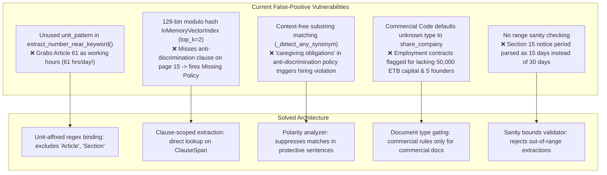

# Implementation Plan: Enhancing No-AI Fact Extraction Accuracy & Eliminating False Positives

**Target Goal**: Transform Kagua's `no_ai` mode (in-memory rule-based/RAG parser + Prolog) into a reliable, high-precision, zero-hallucination compliance engine that operates without external LLMs, eliminating false positive violations on valid employment and commercial documents.

---

## 1. Confirmed Design Decisions (from `/grill-me` Review)

| # | Architecture Decision | Confirmed Approach | Rationale |
|---|---|---|---|
| **1** | **Clause & Fact Sourcing** | **Clause-Scoped Direct Extraction** | Extract parameters directly from paragraphs classified by spaCy/regex clause matchers (`ClauseSpan`), eliminating misses caused by the 128-bin modulo hash vector index with `top_k=2`. |
| **2** | **Numeric Unit Binding** | **Strict Unit-Affixed Regex + Section/Article Exclusion** | Require numbers to bind directly to statutory units (e.g. `60 working days`, `8 hours/day`), while actively rejecting numbers preceded by `Article`, `Section`, `Clause`, `Proclamation`, or years/dates. |
| **3** | **Negation & Polarity Scoping** | **Sentence-Level Polarity & Negation Scoper** | Inspect the sentence context for protective or prohibitive qualifiers (`shall not`, `prohibits`, `without regard to`, `does not discriminate`) to prevent compliant anti-discrimination clauses from triggering restriction violations. |
| **4** | **Domain Guardrails & Gating** | **Document Type Gating & Strict Domain Isolation** | Classify document type (`employment_contract`, `vacancy_announcement`, `commercial_incorporation`). Suppress company formation rules (50k ETB capital, 5 founders) on employment contracts. Never default unknown documents to `share_company`. |
| **5** | **Sanity & Bounds Validation** | **Strict Statutory Domain Bounds Validation** | Validate all extracted values against legal/physical sanity bounds (`1 <= daily_hours <= 18`, `10 <= weekly_hours <= 100`, `14 <= age <= 70`, `1 <= probation_days <= 180`), discarding any outlier that slips past regexes. |

---

## 2. Root Cause Analysis of False Positives in No-AI Mode



---

## 3. Data Flow & Processing Pipeline

```mermaid
sequenceDiagram
    autonumber
    participant Input as Uploaded Document Text
    participant NER as spaCy NER & Clause Classifier
    participant Extractor as Clause-Scoped Unit Extractor
    participant Polarity as Polarity & Negation Scoper
    participant Bounds as Sanity Bounds Validator
    participant Prolog as SWI-Prolog Reasoner Engine

    Input->>NER: extract_entities_and_clauses(text)
    NER-->>Extractor: List of ClauseSpans (text, type, char spans)
    
    rect rgb(20, 30, 45)
        Note over Extractor,Bounds: Deterministic Fact Synthesis (No External LLM)
        Extractor->>Extractor: Bind numbers strictly to units (days, hrs, months)
        Extractor->>Extractor: Reject 'Article X', 'Section Y', dates
        Extractor->>Polarity: Check sentence polarity for protective qualifiers
        Polarity-->>Extractor: Validated positive/negative violations
        Extractor->>Bounds: Validate legal bounds (e.g. 1 <= daily_hrs <= 18)
        Bounds-->>Bounds: Discard outliers & un-parseables
    end

    Bounds->>Prolog: Send clean, vetted facts dict
    Prolog-->>Prolog: Unify facts with statutory Horn clauses
    Prolog-->>Input: True statutory violations (Zero False Positives)
```



---

## 4. Implementation Specifications

### Phase 1: Overhaul Numeric Extraction (`parser/services/rag_engine.py`)

#### 1.1 Fix and Enforce `unit_pattern` in `extract_number_near_keyword`
Replace the unused `unit_pattern` with a strict regex that couples the number to the statutory unit:

```python
ARTICLE_PREFIX_REGEX = re.compile(
    r"\b(?:article|section|sec|clause|art|proc|proclamation|no|p\.l\.c|s\.c)\.?\s*$",
    re.IGNORECASE
)

def extract_strict_unit_number(
    text: str,
    unit_regex: str,
    preceding_exclusion_regex: re.Pattern = ARTICLE_PREFIX_REGEX
) -> tuple[int | None, str | None]:
    """
    Finds numbers directly affixed to statutory units, e.g.:
      - '60 working days'
      - '8 hours a day'
      - '3 (three) months'
    Actively rejects numbers preceded by 'Article', 'Section', 'Clause', or followed by currency/years.
    """
    pattern = rf"(?i)\b({LEGAL_NUM_PATTERN})\s*(?:\([^)]+\)\s*)?{unit_regex}"
    for match in re.finditer(pattern, text):
        num_str = match.group(1)
        start_idx = match.start(1)
        # Check text preceding the number (up to 20 chars)
        prefix = text[max(0, start_idx - 20):start_idx].strip()
        if preceding_exclusion_regex.search(prefix):
            continue  # Skip "Article 61", "Section 14"
        
        val = parse_legal_number(num_str)
        if val is not None:
            # Extract surrounding sentence as snippet
            sent_snippet = text[max(0, match.start() - 40):min(len(text), match.end() + 40)]
            return val, sent_snippet.strip()
            
    return None, None
```

#### 1.2 Clause-Scoped Parameter Extraction
Instead of searching across `retrieved_doc_contexts` (which are limited to `top_k=2` chunks from the 128-bin hash index), scope the search to the clauses detected by NER:

```python
def extract_facts_from_clause_spans(
    clauses: list[dict],
    full_text: str
) -> tuple[dict[str, Any], dict[str, Any]]:
    facts = {}
    provenance = {}

    # Map clause type to specific unit extractors
    for clause in clauses:
        c_type = clause.get("clause_type")
        c_text = clause.get("text", "")

        # 1. Probation Period: require "days" or "months"
        if c_type == "ETHIOPIAN_PROBATION_PERIOD":
            val_days, snip = extract_strict_unit_number(c_text, r"(?:working\s+)?days?")
            val_months, snip_m = extract_strict_unit_number(c_text, r"months?")
            if val_days is not None and 1 <= val_days <= 180:
                facts["probation_days"] = val_days
                provenance["probation_days"] = {"value": val_days, "source_text": snip}
            elif val_months is not None and 1 <= val_months <= 6:
                facts["probation_days"] = val_months * 30
                provenance["probation_days"] = {"value": val_months * 30, "source_text": snip_m}

        # 2. Working Hours: require "hours per day" / "hours a week"
        elif c_type == "ETHIOPIAN_WORKING_HOURS":
            val_day, snip_d = extract_strict_unit_number(c_text, r"(?:hours?|hrs?)\s*(?:per|a|\/)?\s*day")
            val_week, snip_w = extract_strict_unit_number(c_text, r"(?:hours?|hrs?)\s*(?:per|a|\/)?\s*week")
            if val_day is not None and 1 <= val_day <= 18:
                facts["working_hours_per_day"] = val_day
                provenance["working_hours_per_day"] = {"value": val_day, "source_text": snip_d}
            if val_week is not None and 10 <= val_week <= 100:
                facts["weekly_working_hours"] = val_week
                provenance["weekly_working_hours"] = {"value": val_week, "source_text": snip_w}

        # 3. Termination Notice
        elif c_type == "ETHIOPIAN_TERMINATION_NOTICE":
            val_days, snip_d = extract_strict_unit_number(c_text, r"days?")
            val_months, snip_m = extract_strict_unit_number(c_text, r"months?")
            if val_days is not None and 1 <= val_days <= 180:
                facts["notice_period_days"] = val_days
                provenance["notice_period_days"] = {"value": val_days, "source_text": snip_d}
            elif val_months is not None and 1 <= val_months <= 6:
                facts["notice_period_days"] = val_months * 30
                provenance["notice_period_days"] = {"value": val_months * 30, "source_text": snip_m}

        # 4. Annual Leave: require "working days" or "days"
        elif c_type == "ETHIOPIAN_ANNUAL_LEAVE":
            val_days, snip = extract_strict_unit_number(c_text, r"(?:working\s+)?days?")
            if val_days is not None and 1 <= val_days <= 90:
                facts["annual_leave_days"] = val_days
                provenance["annual_leave_days"] = {"value": val_days, "source_text": snip}

        # 5. Maternity Leave: require "days" or "months"
        elif c_type == "ETHIOPIAN_MATERNITY_LEAVE":
            val_days, snip = extract_strict_unit_number(c_text, r"(?:consecutive\s+)?days?")
            val_months, snip_m = extract_strict_unit_number(c_text, r"months?")
            if val_days is not None and 1 <= val_days <= 200:
                facts["maternity_leave_days"] = val_days
                provenance["maternity_leave_days"] = {"value": val_days, "source_text": snip}
            elif val_months is not None and 1 <= val_months <= 6:
                facts["maternity_leave_days"] = val_months * 30
                provenance["maternity_leave_days"] = {"value": val_months * 30, "source_text": snip_m}

    return facts, provenance
```

---

### Phase 2: Polarity & Negation Scoper (`parser/services/rag_engine.py`)

#### 2.1 Implement `is_protective_or_negated_context()`
```python
PROTECTIVE_PATTERNS = [
    r"\b(?:does\s+not|do\s+not|will\s+not|shall\s+not)\s+discriminate\b",
    r"\bwithout\s+(?:regard|distinction)\s+to\b",
    r"\bprohibited\s+from\s+discriminating\b",
    r"\bequal\s+opportunity\b",
    r"\bno\s+employee\s+shall\s+be\s+(?:subjected|discriminated)\b",
    r"\bexcept\s+in\s+(?:an?\s+)?emergency\b",
    r"\bexceptional\s+circumstances?\b"
]

PROTECTIVE_REGEX = re.compile("|".join(PROTECTIVE_PATTERNS), re.IGNORECASE)

def is_protective_or_negated_context(sentence: str) -> bool:
    """Returns True if the sentence is stating a legal safeguard or prohibition against discrimination."""
    return bool(PROTECTIVE_REGEX.search(sentence))
```

#### 2.2 Scoped Synonym Evaluation
When checking for discrimination or restrictions (Articles 14, 87, 88), evaluate only sentences where `is_protective_or_negated_context(sent)` is `False`:

```python
def detect_violation_with_polarity(
    doc_text: str,
    violation_synonyms: list[str]
) -> tuple[bool, str | None]:
    doc = nlp(doc_text)
    for sent in doc.sents:
        sent_text = sent.text.strip()
        sent_lower = sent_text.lower()
        for syn in violation_synonyms:
            if syn in sent_lower:
                if not is_protective_or_negated_context(sent_text):
                    return True, sent_text
    return False, None
```

---

### Phase 3: Document Type Gating & Domain Isolation (`parser/services/ner.py` & `core-be/src/service.rs`)

#### 3.1 Document Classification
Introduce `classify_document_type(text: str) -> str`:
- `employment_contract`: Contains "employment", "employee", "employer", "salary", "wages", "probation".
- `commercial_incorporation`: Contains "articles of association", "memorandum of association", "share company", "private limited company", "subscribers", "founders".
- `commercial_transaction`: Contains "sale of goods", "supply agreement", "commercial agency".

#### 3.2 Gating in `core-be/src/service.rs`
In `core-be/src/service.rs`, when the active domain is `commercial_code` or `all`:
1. Check `company_type`. If neither `plc` nor `share_company` is explicitly found, set `company_type = null` (never default to `share_company`).
2. If `company_type` is `null`, do NOT assert `doc_fact(company_type, share_company)`, preventing share company capital and founder rules from firing.
3. If document type is `employment_contract`, automatically restrict reasoning to `ethiopian_labour_proclamation` unless user explicitly forced commercial domain.

---

### Phase 4: Sanity Bounds & Unit Conversions

#### 4.1 Strict Domain Sanity Dictionary
Define allowed ranges for every legal parameter:

```python
STATUTORY_SANITY_BOUNDS = {
    "probation_days": (1, 180),
    "working_hours_per_day": (1, 18),
    "weekly_working_hours": (10, 100),
    "overtime_hours_per_day": (0, 8),
    "overtime_hours_per_week": (0, 40),
    "notice_period_days": (1, 180),
    "annual_leave_days": (1, 90),
    "maternity_leave_days": (1, 240),
    "sick_leave_months": (1, 12),
    "minimum_worker_age": (14, 75),
    "contract_suspension_days": (1, 365),
    "final_settlement_days": (1, 180),
    "max_wage_deduction_percent": (1, 100),
    "overtime_multiplier_rate": (0.5, 5.0)
}

def validate_statutory_bound(key: str, val: float | int) -> bool:
    bounds = STATUTORY_SANITY_BOUNDS.get(key)
    if not bounds:
        return True
    return bounds[0] <= val <= bounds[1]
```

Any value that violates `validate_statutory_bound` is logged and dropped before sending to Prolog.

---

## 5. Verification & Benchmark Test Plan

| Test ID | Document / Scenario | Trigger Condition | Expected No-AI Outcome |
|---|---|---|---|
| **TC-NA-01** | Standard Compliant Employment Contract (`Ethiopia_Standard_Employment_Contract.pdf`) | 60 days probation, 8 hrs/day, 48 hrs/week, 16 days leave. | **0 False Positives**. No working hours or probation violations. |
| **TC-NA-02** | Anti-Discrimination Policy Clause | Document contains "Company does not discriminate based on gender or marital status." | `hiring_discrimination_detected` is **FALSE**. No Article 14 violation fired. |
| **TC-NA-03** | Section & Article Number Proximity | Document contains "In accordance with Article 61, working hours shall be 8 hours per day." | `working_hours_per_day` is **8** (NOT 61). No excessive hours violation. |
| **TC-NA-04** | Cross-Domain Gating | Employment contract uploaded with domain set to "all" or auto. | Commercial Code rules (50k capital, 5 founders) are **suppressed**; only Labour Law rules evaluated. |
| **TC-NA-05** | Month-to-Day Unit Conversion | Contract states "Probation period of two (2) months." | Extracted as `probation_days = 60` (within Article 11(3) limit). No violation. |
| **TC-NA-06** | Fictional Vacancy 30-Page Document | Complex multi-page vacancy with Sunday reconciliation shifts. | Accurately extracts actual violations (Sunday rest day, 55 hrs/week) while ignoring section numbering. |

---

## 6. Implementation Checklist & Files to Modify

- [ ] `parser/services/rag_engine.py`:
  - Implement `extract_strict_unit_number()` with `ARTICLE_PREFIX_REGEX`.
  - Implement `extract_facts_from_clause_spans()` for direct clause-scoped extraction.
  - Implement `is_protective_or_negated_context()` polarity filter for Article 14/87/88 synonyms.
  - Implement `validate_statutory_bound()` sanity boundary checker.
  - Remove `comp_type = "share_company"` fallback default in Commercial Code extractor.
- [ ] `parser/services/ner.py`:
  - Add `classify_document_type()` helper and expose in parse summary.
- [ ] `core-be/src/service.rs`:
  - In `extract_prolog_facts()`, gate domain rules based on `document_type`.
  - Discard unverified Commercial Code facts if document is purely employment.
- [ ] `reasoner-engine/rules/employment.pl`:
  - Ensure ambiguity warning rules only trigger when `has_*_clause` is true AND the document is not an abbreviated appointment letter.
