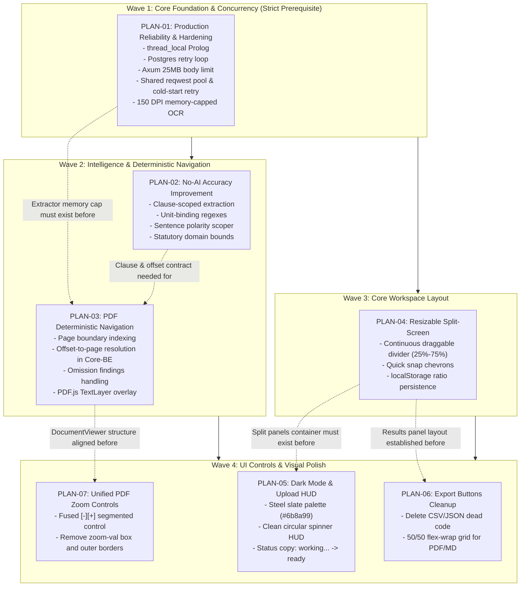

# Kagua System Architecture & Plan Interdependency Overview

## Executive Purpose

This document is the **Master Orchestration Reference** for all engineering agents and developers working on the Kagua compliance platform. It maps out the complete set of implementation plans, establishes strict dependency orderings, identifies shared code hotspots, and defines conflict prevention protocols to guarantee that concurrent or sequential changes do not cause regressions, merge collisions, or architectural drift.

---

## 1. Master Implementation Plans Inventory

The platform evolution is defined across seven specialized implementation plans located in `docs/`:

| Plan ID | File Name | Target Subsystems | Core Architectural Objective |
| :--- | :--- | :--- | :--- |
| **PLAN-01** | [`production_reliability_plan.md`](file:///home/temesgensida/tom/prolog/Kagua/docs/production_reliability_plan.md) | `core-be`, `reasoner-engine`, `parser`, `ui/services` | **Hardened Runtime**: Prolog thread isolation, Postgres connection retries, 25MB body limit, OCR memory caps, health probes, and inter-service cold-start retries. |
| **PLAN-02** | [`no_ai_accuracy_improvement_plan.md`](file:///home/temesgensida/tom/prolog/Kagua/docs/no_ai_accuracy_improvement_plan.md) | `parser`, `reasoner-engine/rules`, `core-be` | **Zero False-Positives**: Clause-scoped extraction, unit-bound regexes, sentence polarity scoping, domain guardrails, and sanity bounds validation. |
| **PLAN-03** | [`pdf_highlight_navigation_plan.md`](file:///home/temesgensida/tom/prolog/Kagua/docs/pdf_highlight_navigation_plan.md) | `parser`, `core-be`, `ui/components`, `ui/services` | **Deterministic Page Jump**: End-to-end page indexing, omission findings badging (`Absence of Clause`), and PDF.js TextLayer highlight overlays. |
| **PLAN-04** | [`horizontal_resizable_split_plan.md`](file:///home/temesgensida/tom/prolog/Kagua/docs/horizontal_resizable_split_plan.md) | `ui/routes`, `ui/components` | **Fluid Split-Screen**: Continuous draggable divider (25%–75%), quick-snap chevrons, and `localStorage` split ratio persistence. |
| **PLAN-05** | [`darkmode_styling_and_clean_upload_plan.md`](file:///home/temesgensida/tom/prolog/Kagua/docs/darkmode_styling_and_clean_upload_plan.md) | `ui/styles`, `ui/components`, `ui/routes` | **Visual Polish & Friendly HUD**: Muted steel slate dark palette (`#6b8a99`), removal of neon glows and laser bar; clean spinner with `"working..."` &rarr; `"on the way..."` &rarr; `"ready"`. |
| **PLAN-06** | [`export_buttons_cleanup_and_layout_plan.md`](file:///home/temesgensida/tom/prolog/Kagua/docs/export_buttons_cleanup_and_layout_plan.md) | `ui/components`, `ui/services` | **Export Streamlining**: Complete deletion of CSV/JSON export code and responsive 50/50 flex-wrap grid for PDF and Markdown export buttons. |
| **PLAN-07** | [`pdf_zoom_buttons_refinement_plan.md`](file:///home/temesgensida/tom/prolog/Kagua/docs/pdf_zoom_buttons_refinement_plan.md) | `ui/components` | **Unified Zoom Pill**: Fused `[-][+]` segmented control, removal of standalone zoom-val box and outer borders, aligned with adjacent buttons. |

---

## 2. File Collision & Touchpoint Hotspot Matrix

Multiple plans touch overlapping source files. Modifying files without respecting the sequence below will cause compile errors, overwritten functionality, or race conditions:

| File Path | PLAN-01 (Reliability) | PLAN-02 (No-AI Accuracy) | PLAN-03 (PDF Navigation) | PLAN-04 (Resizable Split) | PLAN-05 (Dark & Upload) | PLAN-06 (Export Buttons) | PLAN-07 (Zoom Pill) | Collision Risk |
| :--- | :---: | :---: | :---: | :---: | :---: | :---: | :---: | :---: |
| `parser/services/extractor.py` | 🔴 (OCR memory & 150 DPI) | 🟡 (Text normalization) | 🔴 (Page character bounds) | | | | | **CRITICAL** |
| `parser/services/rag_engine.py` | | 🔴 (Clause extraction & regex) | 🟡 (Offset propagation) | | | | | **HIGH** |
| `parser/Dockerfile` | 🔴 (poppler & tesseract) | | | | | | | **LOW** |
| `reasoner-engine/engine.pl` | 🔴 (thread_local & cleanup) | 🟡 (Dynamic facts) | | | | | | **HIGH** |
| `reasoner-engine/rules/*.pl` | | 🔴 (Domain rules bounds) | | | | | | **MEDIUM** |
| `core-be/src/service.rs` | 🔴 (Reqwest retry pool) | 🟡 (Fact harmonization) | 🔴 (Offset-to-page resolution) | | | | | **CRITICAL** |
| `core-be/src/db.rs` | 🔴 (Exponential backoff) | | | | | | | **LOW** |
| `core-be/src/main.rs` | 🔴 (25MB limit, shutdown) | | | | | | | **MEDIUM** |
| `ui/src/routes/(app)/+page.svelte` | | | | 🔴 (Split layout & drag) | 🔴 (Upload spinner & status) | | | **CRITICAL** |
| `ui/src/lib/components/DocumentViewer.svelte` | | | 🔴 (TextLayer & page jump) | | 🟡 (Slate borders) | | 🔴 (Zoom segmented pill) | **CRITICAL** |
| `ui/src/lib/components/AnalysisResultView.svelte` | | | 🔴 (Omission badge & jump) | | 🟡 (Slate palette) | 🔴 (Delete CSV/JSON, 50/50) | | **CRITICAL** |
| `ui/src/lib/services/api.ts` | 🔴 (Timeout & WS reconnect) | | 🟡 (Violation model fields) | | | 🟡 (Dead export types) | | **HIGH** |
| `ui/src/lib/services/exportService.ts` | | | | | | 🔴 (Delete CSV/JSON) | | **MEDIUM** |
| `ui/src/app.css` | | | | | 🔴 (Global steel slate) | | | **MEDIUM** |

---

## 3. Global Interdependency Graph

---

## 4. Phased Execution Order (The 4-Wave Protocol)

To eliminate race conditions and avoid code rework, all development must proceed through the following four sequential waves:

### Wave 1: Core Foundation & Concurrency Safety
*Goal: Ensure the backend, database, reasoner, and parser cannot crash, leak data, or drop connections under load or cold-start.*

- **Execute**: **PLAN-01** ([`production_reliability_plan.md`](file:///home/temesgensida/tom/prolog/Kagua/docs/production_reliability_plan.md))
- **Files Modified**:
  - `reasoner-engine/engine.pl` (thread-local facts, transactional cleanup)
  - `reasoner-engine/server.pl` (exception catching boundary)
  - `core-be/src/db.rs` (Postgres backoff retry loop)
  - `core-be/src/main.rs` (25MB body limit, graceful shutdown, health probes)
  - `core-be/src/service.rs` (resilient HTTP client pool with cold-start backoff)
  - `parser/services/extractor.py` (150 DPI page-by-page OCR, 35-page cap)
  - `parser/Dockerfile` (install `poppler-utils` and `tesseract-ocr`)
- **Exit Gate**: Multi-threaded concurrency test passes without fact collision; database reconnects after simulated outage; 15MB PDF uploads without 413 error.

---

### Wave 2: Accurate Extraction & Deterministic Navigation
*Goal: Guarantee zero false-positive compliance violations and precise character-to-page indexing from extraction to presentation.*

- **Execute**: **PLAN-02** ([`no_ai_accuracy_improvement_plan.md`](file:///home/temesgensida/tom/prolog/Kagua/docs/no_ai_accuracy_improvement_plan.md)) followed by **PLAN-03** ([`pdf_highlight_navigation_plan.md`](file:///home/temesgensida/tom/prolog/Kagua/docs/pdf_highlight_navigation_plan.md)).
- **Interdependency Note**: 
  - PLAN-02 modifies `parser/services/rag_engine.py` and `rules/employment.pl` to produce strictly bounded facts and clause spans.
  - PLAN-03 enhances `parser/services/extractor.py` to preserve page boundary metadata (`pages_meta`) alongside the 150 DPI memory safety from Wave 1.
  - In `core-be/src/service.rs`, PLAN-03 introduces the offset-to-page resolution algorithm, mapping clause spans to actual document pages and tagging statutory omissions (`is_omission: true`).
- **Exit Gate**: Scanning valid contracts yields zero false positives in `no_ai` mode; multi-page contracts (e.g. 30 pages) generate exact `page_number` coordinates for all violations; omissions are flagged without dummy page jumps.

---

### Wave 3: Core Workspace Layout (Split-Screen Architecture)
*Goal: Restructure the frontend application shell into a flexible, horizontally resizable split container.*

- **Execute**: **PLAN-04** ([`horizontal_resizable_split_plan.md`](file:///home/temesgensida/tom/prolog/Kagua/docs/horizontal_resizable_split_plan.md)).
- **Files Modified**:
  - `ui/src/routes/(app)/+page.svelte` (introducing draggable splitter, percentage clamping 25%–75%, snap actions)
  - Container CSS classes in `app.css` / scoped styles.
- **Interdependency Note**: 
  - Must precede Wave 4 because PLAN-05, PLAN-06, and PLAN-07 modify child components located directly inside these left and right split panels. Restructuring the parent container first prevents layout regression.
- **Exit Gate**: User can drag the divider smoothly between 25% and 75%; double-click resets to 58/42; ratio is restored on page reload from `localStorage`.

---

### Wave 4: UI Controls, Clean Upload & Visual Polish
*Goal: Deliver a unified, distraction-free aesthetic with refined controls and optimized actions.*

- **Execute in Parallel or Staggered**:
  - **PLAN-05** ([`darkmode_styling_and_clean_upload_plan.md`](file:///home/temesgensida/tom/prolog/Kagua/docs/darkmode_styling_and_clean_upload_plan.md)):
    - Replaces electric cyan glows with muted steel slate `#6b8a99`.
    - Implements simple circular spinner HUD with lifecycle stages: `"working..."` &rarr; `"on the way..."` &rarr; `"ready"`.
  - **PLAN-06** ([`export_buttons_cleanup_and_layout_plan.md`](file:///home/temesgensida/tom/prolog/Kagua/docs/export_buttons_cleanup_and_layout_plan.md)):
    - Removes `exportReportAsJson` and `exportReportAsCsv` dead code from `exportService.ts`.
    - Formats `DOWNLOAD PDF` and `EXPORT BRIEF (MD)` in a responsive 50/50 flex-wrap grid.
  - **PLAN-07** ([`pdf_zoom_buttons_refinement_plan.md`](file:///home/temesgensida/tom/prolog/Kagua/docs/pdf_zoom_buttons_refinement_plan.md)):
    - Unifies zoom buttons into an attached segmented pill `[-][+]` using Lucide icons.
    - Removes standalone zoom percentage box and outer border box.
- **Exit Gate**: Uploading a document shows only the circular spinner and clean copy; dark mode has zero glaring beams; export buttons never overflow; zoom pill matches the adjacent Expand button; all automated type checks pass (`pnpm check`).

---

## 5. Agent Conflict Prevention Rules

When executing any task across this repository, autonomous agents must adhere to the following non-negotiable protocols:

1. **Strict Plan Ordering**:
   Never start an item from a later Wave if an earlier Wave prerequisite is incomplete.
2. **Atomic Hotspot Editing**:
   When editing high-collision files (`extractor.py`, `service.rs`, `+page.svelte`, `DocumentViewer.svelte`), an agent must verify that previous enhancements from other plans are preserved:
   - *Example*: In `extractor.py`, adding page indexing (PLAN-03) must NOT revert the 150 DPI page cap (PLAN-01).
   - *Example*: In `DocumentViewer.svelte`, adding the zoom pill (PLAN-07) must NOT remove the PDF.js TextLayer highlight container (PLAN-03).
3. **Preservation of Interfaces**:
   Changes to models in `core-be/src/models.rs` or `ui/src/lib/services/api.ts` must maintain backward compatibility or update both ends synchronously within the same wave.
4. **Automated Verification Milestone**:
   At the conclusion of each wave:
   - Rust: `cargo check` & `cargo test` in `core-be`.
   - SvelteKit: `pnpm --filter ui check` in `ui`.
   - Python: Syntax check via `python -m py_compile` across `parser/services/*.py`.
   - Prolog: Verification via `swipl -g "use_module(engine), halt." reasoner-engine/engine.pl`.

---

## 6. Implementation Status & Verification Matrix

| Wave | Plan ID | Target Plan | Status | Verification Summary |
| :---: | :---: | :--- | :---: | :--- |
| **Wave 1** | **PLAN-01** | Production Reliability & Hardening | ✅ **COMPLETED** | Thread-isolated Prolog facts (`:- thread_local user:doc_fact/2.`), Postgres exponential backoff, Axum 25MB limits, shared Reqwest client with warmup retries, 150 DPI OCR memory caps. |
| **Wave 2** | **PLAN-02** | No-AI Accuracy Improvement | ✅ **COMPLETED** | Unit-bound regexes (`extract_number_near_keyword`), statutory sanity bounds (`STATUTORY_SANITY_BOUNDS`), polarity-aware context analysis (`is_protective_or_negated_context`), domain gating (`classify_document_type`). |
| **Wave 2** | **PLAN-03** | PDF Highlight & Deterministic Navigation | ✅ **COMPLETED** | Character offset-to-page indexing (`pages_meta`), backend page resolution, omission findings distinction (`is_omission: true`), pinpoint jump navigation. |
| **Wave 3** | **PLAN-04** | Horizontally Resizable Split Container | ✅ **COMPLETED** | Fluid draggable divider (25%–75%), quick snap buttons (30% collapse, 72% expand), double-click reset (58%), `localStorage` persistence, full keyboard a11y. |
| **Wave 4** | **PLAN-05** | Dark Mode Palette & Clean Upload HUD | ✅ **COMPLETED** | Calm Steel Slate & Muted Greyish-Blue (`#6b8a99` / `#4a6775`), zero glowing neon beams/cyan text shadows, clean circular ring spinner HUD with friendly copy (`working...` &rarr; `on the way...` &rarr; `ready`). |
| **Wave 4** | **PLAN-06** | Export Buttons Cleanup & Layout | ✅ **COMPLETED** | Removed JSON/CSV export dead code; responsive 50/50 flex-wrap grid for `DOWNLOAD PDF` and `EXPORT BRIEF (MD)` preventing card overflow. |
| **Wave 4** | **PLAN-07** | PDF Zoom Buttons Refinement | ✅ **COMPLETED** | Fused `[-][+]` segmented pill zoom controls, removed separate percentage indicator and outer borders, aligned with adjacent actions. |
| **Global** | **-** | Default AI Setting | ✅ **COMPLETED** | AI assistant defaults ON (`enabledState = true`), user togglable. |
