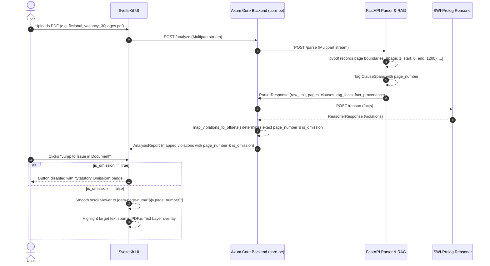

# Implementation Plan: Deterministic Document Page Navigation & Highlighting

**Target Goal**: Eliminate wrong-page navigation when clicking "Jump to Issue in Document" or violation cards in Kagua, ensuring 100% deterministic scrolling and dual-layer visual highlighting across multi-page documents (e.g., 30-page vacancy contracts).

---

## 1. Confirmed Design Decisions (from `/grill-me` Review)

| # | Architecture Decision | Confirmed Approach | Rationale |
|---|---|---|---|
| **1** | **Source of Truth for Pages** | **End-to-End Page Indexing** | Python parser tracks character bounds `[start_char, end_char]` per page; Core-BE maps violation offsets to `page_number`; UI uses deterministic scrolling without heuristic guessing. |
| **2** | **Omission Findings Handling** | **Disable Jump + 'Absence of Clause' Badge** | Statutory omissions (missing harassment policy, missing severance) do not exist in the contract text. Disabling the jump button and displaying an explicit badge prevents confusing jumps to Page 1. |
| **3** | **Visual Highlighting Granularity** | **Dual-Layer Highlighting** | Smooth-scrolls the container to the exact target page AND renders a pulsating highlight over the offending text snippet/line. |
| **4** | **PDF Canvas Highlighting Technique** | **PDF.js Standard Text Layer** | Overlays the official PDF.js text layer on the canvas, providing pixel-perfect text highlight spans and user text selection. |
| **5** | **Primary Benchmark Assets** | `fictional_vacancy_30pages.pdf` & `Ethiopia_Standard_Employment_Contract.pdf` | Validates both dense multi-page edge cases and standard short contracts. |

---

## 2. Root Cause Analysis

```mermaid
flowchart TD
    subgraph Current Flawed Flow
        P_Old["extractor.py<br/>Flatten text: '\n\n'.join(pages_text)<br/>❌ Discards page boundaries"]
        BE_Old["service.rs<br/>Fallback: raw_text[0..200]<br/>❌ Defaults unmapped to Page 1"]
        UI_Old["DocumentViewer.svelte<br/>Splits Prolog title & description<br/>❌ Searches rule keywords across all pages"]
        Err["Result: Jumps to Page 1 or random page"]
        P_Old --> BE_Old --> UI_Old --> Err
    end

    subgraph Proposed Deterministic Flow
        P_New["extractor.py<br/>Extract pages with char boundaries<br/>✅ [{page_number, start_char, end_char}]"]
        BE_New["service.rs<br/>Map offset to page_number & is_omission<br/>✅ No Page 1 fallback"]
        UI_New["DocumentViewer.svelte + Text Layer<br/>Deterministic scroll to page_number<br/>✅ Pixel-perfect in-page highlight box"]
        Success["Result: Exact page & clause highlighted"]
        P_New --> BE_New --> UI_New --> Success
    end
```



### Detailed Breakdown of Failures in Existing Codebase
1. **Destructive Flattening in `parser/services/extractor.py`**:
   `pypdf.PdfReader` reads page-by-page, but line 56 merges them into `raw_text = "\n\n".join(pages_text)`. Spans generated in subsequent NER/RAG steps have global character offsets, but zero page association.
2. **Page 1 Default Slice in `core-be/src/service.rs`**:
   Lines 584–590 fallback to `safe_char_slice(raw_text, 0, 200)` when a violation doesn't match a hardcoded regex clause. Characters 0..200 are physically on Page 1, creating a false snippet that matches Page 1.
3. **Prolog Metadata Leakage into Heuristic Search (`DocumentViewer.svelte`)**:
   Lines 174–190 split `v.title` and `v.description` into search terms. Words like `"contract"`, `"schedule"`, `"hours"`, `"statutory"` are Prolog rule commentary, not document text, resulting in arbitrary page scoring.
4. **Missing Distinction for Negative/Omission Rules**:
   Prolog rules such as `\+ doc_fact(has_sexual_harassment_policy, true)` represent things that are *missing*. Treating them as text-located violations forces the viewer to search for non-existent text.
5. **Canvas-Only Rendering Without Text Layer**:
   `DocumentViewer.svelte` renders to `<canvas>` only. Highlighting was done by applying a glowing border to the entire page wrapper (`.pulse-page-highlight`), rather than highlighting the specific line on the page.

---

## 3. Architecture & Data Flow



---

## 4. Implementation Specifications

### Phase 1: FastAPI Parser (`parser/`)

#### 1.1 Update `parser/services/extractor.py`
Modify `extract_text_from_pdf` and `_ocr_pdf_bytes` to return structured page metadata alongside text:

```python
class PageSpan(BaseModel):
    page_number: int
    start_char: int
    end_char: int
    char_count: int

def extract_text_from_pdf(stream_bytes: bytes) -> tuple[str, bool, list[dict]]:
    reader = pypdf.PdfReader(io.BytesIO(stream_bytes))
    pages_text = []
    page_map = []
    current_char = 0

    for idx, page in enumerate(reader.pages, start=1):
        text = page.extract_text() or ""
        text_len = len(text)
        page_map.append({
            "page_number": idx,
            "start_char": current_char,
            "end_char": current_char + text_len,
            "char_count": text_len
        })
        pages_text.append(text)
        current_char += text_len + 2  # account for \n\n delimiter

    extracted = "\n\n".join(pages_text)
    # Return (extracted, ocr_used, page_map)
```

#### 1.2 Tag Clauses & Provenance in `parser/services/ner.py` and `rag_engine.py`
Add a helper `get_page_for_offset(char_offset: int, page_map: list[dict]) -> int` to attach `page_number` to each `ClauseSpan` and `fact_provenance` entry.

#### 1.3 Expose in `parser/main.py`
Update `response_payload` in `/parse` to include:
```python
"pages": page_map
```

---

### Phase 2: Core Backend (`core-be/`)

#### 2.1 Update Models (`core-be/src/models.rs`)
Add `PageSpan` to `ParserResponse` and update `MappedViolation`:

```rust
#[derive(Debug, Clone, Serialize, Deserialize)]
pub struct PageSpan {
    pub page_number: usize,
    pub start_char: usize,
    pub end_char: usize,
    pub char_count: usize,
}

#[derive(Debug, Clone, Serialize, Deserialize)]
pub struct MappedViolation {
    pub domain: String,
    pub rule: String,
    pub title: String,
    pub severity: String,
    pub description: String,
    pub recommendation: String,
    pub snippet: Option<String>,
    pub start_char: Option<usize>,
    pub end_char: Option<usize>,
    pub page_number: Option<usize>,       // NEW: Exact PDF/document page
    pub is_omission: bool,                 // NEW: True if clause is absent
    pub article_citation: Option<String>,
    pub statutory_text: Option<String>,
}
```

#### 2.2 Refactor `map_violations_to_offsets` in `core-be/src/service.rs`
1. **Detect Omission Rules**: Identify rules checking for missing mandatory provisions:
   ```rust
   let is_omission = v.title.to_lowercase().contains("missing")
       || v.rule.contains("Article 14(1)(f)")  // Anti-discrimination
       || v.rule.contains("Article 14(1)(h)")  // Sexual harassment
       || v.rule.contains("Article 6")         // Written contract
       || v.rule.contains("Article 39") && v.title.contains("Missing");
   ```
2. **Eliminate the False Page 1 Fallback**:
   Remove lines 584–590 that assigned `safe_char_slice(raw_text, 0, 200)` to unmatched violations. If a violation is an omission or has no detected span, set `snippet: None`, `start_char: None`, `end_char: None`, and `page_number: None`.
3. **Lookup Exact Page Number**:
   When `start_char` is present, resolve `page_number` by checking which `PageSpan` contains `start_char`.

---

### Phase 3: SvelteKit Frontend (`ui/`)

#### 3.1 Update TypeScript Models (`ui/src/lib/services/api.ts`)
```typescript
export interface MappedViolation {
  domain: string;
  rule: string;
  title: string;
  severity: 'critical' | 'warning' | 'info';
  description: string;
  recommendation: string;
  snippet?: string;
  start_char?: number;
  end_char?: number;
  page_number?: number;      // Exact page number from backend
  is_omission?: boolean;     // Flag for missing provisions
  article_citation?: string;
  statutory_text?: string;
}
```

#### 3.2 Implement PDF.js Text Layer in `ui/src/lib/components/DocumentViewer.svelte`
1. **Render Text Layer**: Alongside the canvas, render a `<div class="textLayer">` for each page wrapper using `pdfjsLib.renderTextLayer`.
2. **Deterministic Scroll**:
   ```typescript
   if (v.is_omission) {
     return; // Do not scroll for omissions
   }
   
   const targetPage = v.page_number ?? calculateFallbackPage(v);
   const targetPageEl = pdfCanvasContainer.querySelector(`[data-page-num="${targetPage}"]`);
   if (targetPageEl && viewerContainer) {
     viewerContainer.scrollTo({
       top: pdfCanvasContainer.offsetTop + targetPageEl.offsetTop - 20,
       behavior: 'smooth'
     });
   }
   ```
3. **In-Page Text Highlighting**:
   Search the rendered text layer spans on `targetPageEl` for `v.snippet` and apply `.pulse-text-highlight` (yellow glowing background with animated pulse) for 2.5 seconds.
4. **Purge Heuristic Title/Description Keyword Matching**:
   Remove the code that split Prolog `v.title` and `v.description` into generic keywords.

#### 3.3 Update `ui/src/lib/components/AnalysisResultView.svelte`
1. **Page Badge**: When `violation.page_number` exists, render a badge:
   ```svelte
   <span class="page-badge">PAGE {violation.page_number}</span>
   ```
2. **Omission Handling**:
   ```svelte
   {#if violation.is_omission}
     <div class="omission-notice-badge">
       <AlertCircle size={13} />
       <span>Statutory Omission (Absent from Document)</span>
     </div>
   {:else}
     <button type="button" class="jump-doc-btn" onclick={() => selectViolation(idx)}>
       <MapPin size={13} />
       {activeViolationIndex === idx ? "Highlighting in Document..." : `Jump to Page ${violation.page_number || ''}`}
     </button>
   {/if}
   ```

---

## 5. Verification & Test Plan

| Test Case | Target Document | Expected Behavior | Verification Status |
|---|---|---|---|
| **TC-01: Multi-Page Navigation** | `ui/static/fictional_vacancy_30pages.pdf` | Clicking violations on Article 61 (hours), Article 11 (probation), or Article 59 (deductions) navigates to their exact page (e.g., Page 12, Page 22) instead of Page 1. | Pending execution |
| **TC-02: In-Page Dual Highlighting** | `ui/static/fictional_vacancy_30pages.pdf` | The target page smoothly scrolls into view AND the specific offending sentence pulses with a yellow highlight box. | Pending execution |
| **TC-03: Statutory Omissions** | `ui/static/fictional_vacancy_30pages.pdf` | Violations like "Missing Sexual Harassment Policy" or "Missing Anti-Discrimination Policy" render the `Statutory Omission` badge and have the Jump button disabled. | Pending execution |
| **TC-04: Short Standard Contract** | `ui/static/Ethiopia_Standard_Employment_Contract.pdf` | 2-page contract accurately highlights Page 1 and Page 2 clauses without offset misalignment. | Pending execution |
| **TC-05: Non-PDF Text Formats** | Test `.docx` and `.txt` files | Fallback text viewer correctly scrolls to character offset and highlights without errors. | Pending execution |

---

## 6. Implementation Dependencies & File Checklist

- [ ] `parser/services/extractor.py`: Add `PageSpan` tracking in `extract_text_from_pdf` and `_ocr_pdf_bytes`.
- [ ] `parser/services/ner.py`: Attach `page_number` to `ClauseSpan`.
- [ ] `parser/main.py`: Expose `pages` array in `/parse` response.
- [ ] `core-be/src/models.rs`: Add `page_number` and `is_omission` to `MappedViolation` and `ParserResponse`.
- [ ] `core-be/src/service.rs`: Implement page offset mapping and remove `0..200` Page 1 fallback.
- [ ] `ui/src/lib/services/api.ts`: Add `page_number` and `is_omission` fields to TypeScript interface.
- [ ] `ui/src/lib/components/DocumentViewer.svelte`: Add PDF.js Text Layer and deterministic page navigation.
- [ ] `ui/src/lib/components/AnalysisResultView.svelte`: Add `PAGE X` chip, omission badge, and conditional Jump button.
