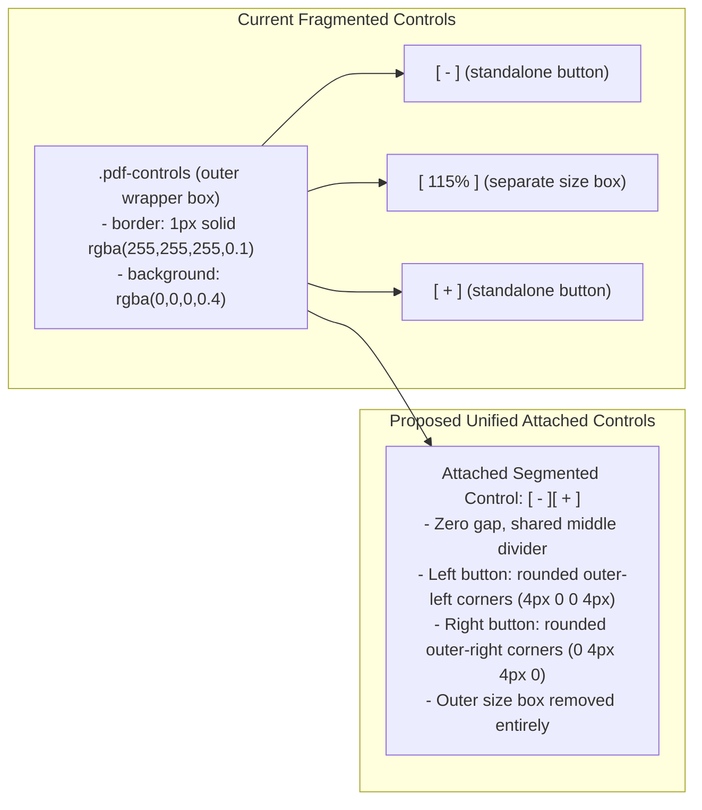

# Implementation Plan: Unified Attached PDF Zoom Controls `[-][+]`

**Target Goal**: Simplify and polish the PDF zoom management controls in `DocumentViewer.svelte`:
1. Remove the separate percentage size box (`<span class="zoom-val">`).
2. Remove the loose outer container wrapper (`.pdf-controls` background/border).
3. Fuse the `Zoom Out` and `Zoom In` buttons into a seamless, attached segmented pill pair `[-][+]` using Lucide SVG icons (`Minus` & `Plus`), matching the adjacent `EXPAND` button height and border style.

---

## 1. Confirmed Design Decisions (from `/grill-me` Review)

| # | Architecture Decision | Confirmed Approach | Rationale |
|---|---|---|---|
| **1** | **Zoom Percentage Box Handling** | **Compact Joined Button Pair `[-][+]`** | Remove the `<span class="zoom-val">` text box entirely; fuse `-` and `+` into an attached segmented button group, reflecting current zoom % in the hover tooltip. |
| **2** | **Icons & Visual Style** | **Lucide Vector Icons (`Minus` & `Plus`)** | Use sharp Lucide SVG icons (`size={13}`) matching the adjacent `EXPAND` button height (~28px) and border (`#132E35`) for crisp, pixel-perfect alignment. |
| **3** | **Border Radius & Junction** | **Segmented Pill Geometry** | Left button (`Minus`): `border-radius: 4px 0 0 4px; border-right: none;`. Right button (`Plus`): `border-radius: 0 4px 4px 0;`. |
| **4** | **Theme Consistency** | **Dual Theme Matching (Dark & Light)** | Inherits dark mode `#132E35` borders and light mode `#8a9aa8` borders matching the `EXPAND` button. |

---

## 2. Technical Architecture & Transformation Map



---

## 3. Step-by-Step Implementation Specifications

### Phase 1: Update Imports & Markup (`ui/src/lib/components/DocumentViewer.svelte`)

#### 1.1 Add Lucide Icons Import
Import `Minus` and `Plus` from `@lucide/svelte`:
```typescript
import { FileText, Maximize2, Minimize2, AlertTriangle, Minus, Plus } from '@lucide/svelte';
```

#### 1.2 Update Header Actions HTML Template
Replace lines 270–276 in `DocumentViewer.svelte`:
```svelte
<!-- Before: -->
<!--
<div class="pdf-controls">
  <button type="button" class="ctrl-btn" onclick={() => changeZoom(-0.15)} title="Zoom Out">&minus;</button>
  <span class="zoom-val">{Math.round(zoomLevel * 100)}%</span>
  <button type="button" class="ctrl-btn" onclick={() => changeZoom(0.15)} title="Zoom In">&plus;</button>
</div>
-->

<!-- After: Attached Segmented Zoom Pair -->
<div class="pdf-zoom-group">
  <button
    type="button"
    class="zoom-btn zoom-out"
    onclick={() => changeZoom(-0.15)}
    title={`Zoom Out (${Math.round(zoomLevel * 100)}%)`}
  >
    <Minus size={13} />
  </button>
  <button
    type="button"
    class="zoom-btn zoom-in"
    onclick={() => changeZoom(0.15)}
    title={`Zoom In (${Math.round(zoomLevel * 100)}%)`}
  >
    <Plus size={13} />
  </button>
</div>
```

---

### Phase 2: CSS Styling Specifications (`ui/src/lib/components/DocumentViewer.svelte`)

Replace `.pdf-controls`, `.ctrl-btn`, and `.zoom-val` CSS rules with the attached segmented control styles:

```css
/* Attached Segmented Zoom Control Group */
.pdf-zoom-group {
  display: inline-flex;
  align-items: center;
  height: 28px;
  box-shadow: 2px 2px 0 rgba(0, 0, 0, 0.25);
  border-radius: 4px;
}

.zoom-btn {
  display: inline-flex;
  align-items: center;
  justify-content: center;
  width: 28px;
  height: 28px;
  padding: 0;
  background: rgba(13, 23, 36, 0.95);
  border: 1px solid #132E35;
  color: #e2f1f8;
  cursor: pointer;
  transition: all 0.2s cubic-bezier(0.16, 1, 0.3, 1);
  box-sizing: border-box;
}

/* Left button: outer-left rounded corners & no right border to attach cleanly */
.zoom-btn.zoom-out {
  border-radius: 4px 0 0 4px;
  border-right: 1px solid rgba(19, 46, 53, 0.6);
}

/* Right button: outer-right rounded corners */
.zoom-btn.zoom-in {
  border-radius: 0 4px 4px 0;
  border-left: none;
}

.zoom-btn:hover {
  background: #1c3f48;
  border-color: #2a5863;
  color: #ffffff;
}

.zoom-btn:active {
  transform: translateY(1px);
}

/* ─── Light Mode Overrides ─── */
:global([data-theme="light"]) .pdf-zoom-group {
  box-shadow: 2px 2px 0 rgba(0, 0, 0, 0.1);
}

:global([data-theme="light"]) .zoom-btn {
  background: rgba(194, 198, 202, 0.95);
  border-color: #8a9aa8;
  color: #2d3a45;
}

:global([data-theme="light"]) .zoom-btn.zoom-out {
  border-right-color: rgba(138, 154, 168, 0.6);
}

:global([data-theme="light"]) .zoom-btn:hover {
  background: #69818d;
  border-color: #69818d;
  color: #ffffff;
}

/* ─── Mobile Responsiveness ─── */
@media (max-width: 640px) {
  .pdf-zoom-group {
    height: 24px;
  }

  .zoom-btn {
    width: 24px;
    height: 24px;
  }
}
```

---

## 4. Verification & Testing Checklist

| Test Case | Interaction / Screen | Expected Behavior |
|---|---|---|
| **TC-ZOOM-01: Attached Button Geometry** | Inspect PDF header controls. | `-` and `+` buttons are physically attached with zero gap and shared inner border; no loose outer wrapper box. |
| **TC-ZOOM-02: Size Box Removal** | Inspect between `-` and `+`. | The separate percentage box (`115%`) is completely removed. |
| **TC-ZOOM-03: Zoom Out Action** | Click `-` button. | Document canvas zooms out smoothly; sound click plays; tooltip reflects new zoom percentage. |
| **TC-ZOOM-04: Zoom In Action** | Click `+` button. | Document canvas zooms in smoothly; sound click plays; tooltip reflects new zoom percentage. |
| **TC-ZOOM-05: Visual Alignment with EXPAND** | Inspect header action row. | The attached `[-][+]` group matches the height (~28px), border color, and drop-shadow of the adjacent `EXPAND` button. |
| **TC-ZOOM-06: Dual Theme Appearance** | Toggle Dark / Light theme. | Attached buttons shift cleanly from dark teal/slate (`#132E35`) to light slate (`#8a9aa8`) with perfect contrast. |
